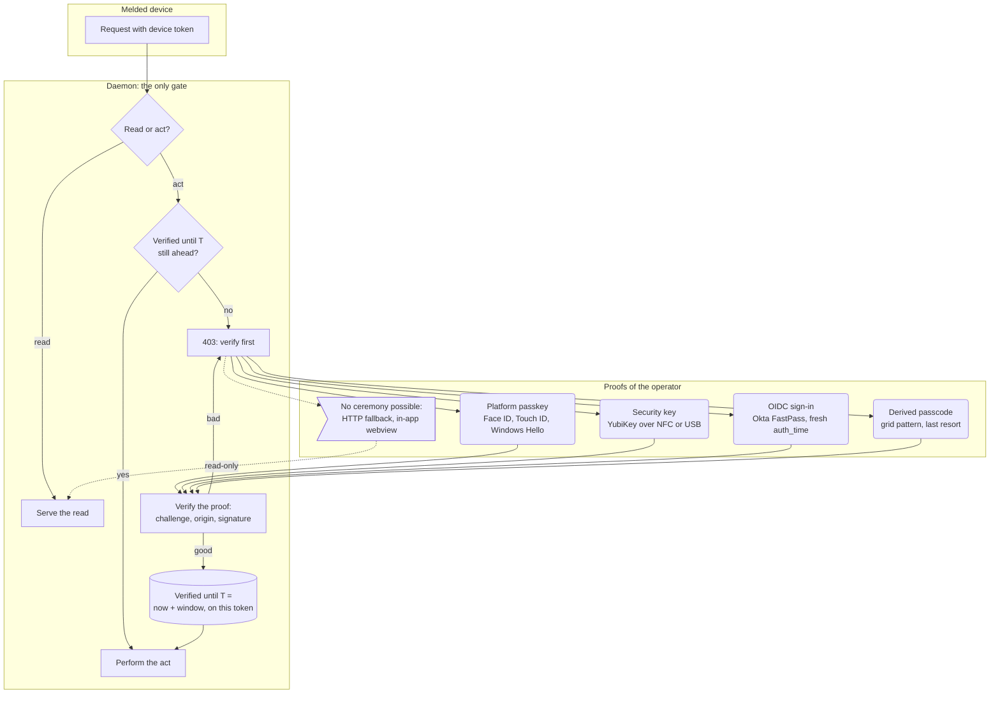

# Operator Verification

A melded device must prove the operator is holding it before it acts, and
the daemon is the only judge of that proof. This page is the design, and
the record of what is built: **phases 2 to 4 of six**, the gate
(`src/daemon/verification-gate.ts`) and passkeys and keys: the WebAuthn
verifier (`src/webauthn/`), the enrolled credentials
(`src/db/credentials.ts`), the ceremonies
(`src/daemon/verification-ceremony.ts`), the page that runs them (`GET
/verify`, `src/daemon/verify-page.ts`), and the app's lock sheet and
enrollment (`expo/lib/verification.ts`, `expo/components/LockSheet.tsx`,
`expo/components/CredentialsSection.tsx`). The gate stays `off` until the
operator enrolls a credential and runs `brane config verification
passkey`; with it off every device token counts as verified forever. The
pieces from before are
per-device tokens (#549, #552), the lapse for unused tokens (#555), the
Devices list (#558), and the presence check (`src/presence.ts`,
[Presence Check](presence.md)). The file keeps its old name so that every
link to it still resolves; passkeys are one of its proof tiers, not the whole
of it.

## The threat

A melded device holds one long-lived token, and that token both names the
device and lets it act. Someone holding the unlocked phone with the app open
therefore has, with no further prompt (claude-bu1kt8a5:4):

- a keyboard into every agent's tmux pane, which is a shell as the operator's
  account on this machine;
- spawn in any registered fold, signals into any narrative, every
  narrative's history and payloads;
- **Meld**, which mints a fresh token for a device they keep, and **revoke**,
  which signs the operator out.

The phone's own lock screen is the only thing in the way, and it is the thing
the threat assumes already bypassed. The same holds for an unlocked laptop
with the app open.

## The rule

**A token says which device; a proof says the operator is holding it now.**
The two were one thing, and this design splits them. The device token stays
the credential every request authenticates with, and keeps working for
reads. An *act* additionally needs the token to have been **verified**
recently: the daemon holds, per token, a `verified_until`, advanced only when
it has itself checked a proof of the operator, and every act route refuses a
token whose `verified_until` is in the past.

Three things follow, and they are the whole argument.

1. **The daemon is the locus, so a client cannot loosen it.** A forked or
   outdated app can skip the prompt; it cannot skip the check, which runs on
   the daemon. With WebAuthn the enforcement is cryptographic, not a
   courtesy: the daemon accepts only an assertion by an enrolled key over a
   challenge the daemon issued, and the signed `clientData` carries the
   origin, which must be the daemon's own hostname. A browser refuses to sign
   for an RP ID that is not its origin's host or a registrable suffix of it,
   so a page on any other origin cannot produce one, however it was patched
   (claude-bu1kt8a5:6).
2. **Every proof tier satisfies one check**, so "device security posture" is
   configuration: Face ID and a ten-minute window for one operator; OIDC
   required, so the organisation's identity provider decides who may act and
   a disabled account stops at the next re-verification; a window of zero,
   so every act prompts (claude-bu1kt8a5:14).
3. **The old rule survives as a corollary.** The earlier design said "a
   passkey guards minting a token, never using one" (claude-pbg4whll:21).
   Minting is an act, so it is still guarded; so now is everything else
   that can hurt. What that rule was protecting — a browser that cannot do
   WebAuthn must never be locked out of brane — is kept for reads: a device
   that cannot produce any proof is read-only, never broken.

## The gate

### What is an act

**Default deny.** The gate holds a *free list* (`FREE_ROUTES`,
`src/daemon/verification-gate.ts`), and everything a device token sends
that is not on it is an act. That mirrors `AGENT_ROUTES`
(`src/daemon/agent-scope.ts`): a route or socket message added later starts
out gated until someone decides otherwise. The first draft of this page
listed acts instead, and the review found two it had missed within the hour
(claude-vxnhxcg9:6, findings 1 and 2). `ACT_ROUTES` names today's acts, so
the fresh class can be configured by name; a route on neither list is an
unnamed act. `src/test/verification-gate.test.ts` reads every route literal
in `server.ts` and fails until each is on one list or the other.

**Free**, because it executes nothing, speaks as nobody, reaches nowhere
and cuts nobody off:

| Free | Where |
|---|---|
| Every read, **named**, never "every `GET`" | `GET /api/status`, `/api/branes`, `/api/protocols` and `/pending`, `/api/folds`, `/api/narratives` and `/recent`, `/api/narratives/:id` and its `/events`, `/export`, `/tool_uses`, `/tool_uses/:key`, `/api/payloads/:nid/*`, `/api/files` and `/list`, `/find`, `/api/wiki/read`, `/api/wiki/asset`, `/api/spawn-history`, `/api/run-history`, `/api/tokens` (the Devices list), `/api/absorb/survey`; `POST /api/search`, `/api/wiki/search`, `/api/diagram`, `/api/highlight`, `/api/memory/index`. A WebSocket upgrade is a `GET` too: `GET /ws/control` and `GET /ws/terminal/:nid` are free to open, and each message is then judged on its own; `GET /ws/mcp` under a device token is an act (below). So no rule by method: a blanket "every `GET`" would free that upgrade and any acting `GET` added later (claude-vxnhxcg9:9) |
| Terminal housekeeping | `/ws/terminal/:nid` messages `start`, `stop`, `resize`, `refresh` |
| The verification routes themselves | `POST /api/verify/begin`, `/api/verify/challenge`, `/api/verify/webauthn`, the OIDC pair, `/api/verify/end`; `GET /api/credentials` (the list), and the enrollment page's `POST /api/credentials/challenge` and `POST /api/credentials`, which carry an approval rather than a token; `POST /api/presence/cancel`, a device's cancel of a prompt at the Mac |
| Operator housekeeping | registering and archiving folds and branes, archiving a narrative, absorb, cost backfill and reprice, the tool-use hook: reversible, nothing executes, nothing leaves the machine. Listed so the choice is visible; moving one across the line is a one-row change (open question 4) |
| The MCP bridge under an **agent** token | `GET /ws/mcp`: the agent's own channel, never gated (below) |

**Acts**, which is to say everything else. The ones that exist today, so
the line can be argued with:

| Act | Where it arrives | Note |
|---|---|---|
| Terminal keystrokes, paste, mouse, clearing history | `/ws/terminal/:nid`, messages `keys`, `paste`, `mouse`, `clear_history` | Checked **per message**, not per connection: a pane opened at minute 9 would otherwise type forever. `mouse` is a keyboard too: its fields reach `tmux send-keys` (claude-vxnhxcg9:6, finding 2). `clear_history` destroys scrollback. |
| A signal | `POST /api/narratives/:id/signal`; `/ws/control` message `signal` | Speaking as the operator (`src/daemon/signal-source.ts`). |
| Spawn, run, revive | `POST /api/spawn`, `POST /api/run`, `POST /api/revive/:nid` | Starts a process as this account. |
| Mint a device token | `POST /api/tokens`, `POST /api/tokens/remote` | Extends reach. From the shell the presence gate asks as well ([Presence Check](presence.md#the-gate)). **Fresh class** (The window). |
| Dial the MCP bridge with a **device** token | `GET /ws/mcp` under a device token | The daemon mints an external narrative and hands back its **agent token** in `welcome.bind_secret` (`mintExternalNarrativeWithSecret`), and agent tokens are never gated, so this is a mint, not a read (claude-vxnhxcg9:6, finding 1). Only `brane mcp --token` does it; the app never does. **Fresh class.** A reconnect that presents the secret is an agent, not a device. |
| Revoke, rotate, forget | `POST /api/tokens/:id/revoke`, `POST /api/token/rotate`, `POST /api/token/forget` | Cuts the operator off. Answers [Token Rotation](token-rotation.md)'s open question: a verified operator guards revoking, as it guards every act. |
| Enroll or revoke a credential | `POST /api/credentials/begin` (the approval the enrollment page redeems), `POST /api/credentials/:id/revoke` | Changes who can verify. **Fresh class**, so with the gate on an existing credential approves every new one; enrollment also needs presence or attestation, below. |
| Approve or revoke a protocol | `POST /api/protocols/approve` (`approve-protocol`), `POST /api/protocols/revoke` (`revoke-protocol`) | Puts a `home` or `fold` protocol file in force for every agent that reads it ([Protocols](protocols.md#approval)). Approve is **fresh class**, and from the shell the presence gate asks as well. An operator who set `verification.fresh` before this act existed should add `approve-protocol` to it. |

Reads stay on the device token. Whether an unverified device should keep
them is the operator's call; **the default is yes** (claude-bu1kt8a5:16,
question 1). A snatched phone then leaks what was already on its screen, and
cannot type into a shell or mint a token. Narrowing it is a config value,
not a redesign.

### Who is gated

| Standing | Gated | Why |
|---|---|---|
| `device` token (a melded phone or laptop, the app on this machine's browser included) | yes | The threat. Who is asking is read from the token's kind, never the address, as the presence gate does. |
| `agent` token | **never** | An agent cannot do Face ID. Its boundary is `AGENT_ROUTES` (`src/daemon/agent-scope.ts`), which already excludes the terminal, signals, and every token route. An agent token exists only because of an act: a spawn, a revive, or a device dialing `/ws/mcp`, all gated above. |
| `local` (tokenless, over `daemon.sock`) | never | It *is* this account on this machine; the acts that reach off it are already held by the presence gate. This is also the recovery path, below. |

### The refusal

An act from an unverified device token is refused with **`403`** and a body
of `{ "error": …, "verification": "required" }`; on a socket, the message is
dropped and a `{ "type": "verify" }` frame is sent back. Not `401`: the app
treats any `401` as "this token was revoked" and signs the daemon out
(`expo/lib/api.ts`, the unauthorized listener, and `markSignedOut` in
`expo/app/_layout.tsx`), which is right for a dead token and wrong for a
live one awaiting a proof. The presence gate already answers `403` with a
body for the same reason (claude-vxnhxcg9:6, finding 4). The app shows the
lock sheet and retries once verified. Nothing else is in the refusal: the
challenge is fetched by the ceremony page itself, because the page must hold
it *before* the tap (below).

### The window

`verified_until = now + window`. The window is a config value,
**default 10 minutes** (claude-bu1kt8a5:16, question 2); zero means every act
prompts, which the gate implements by spending the proof on the act it let
through. Every act: on the terminal each `keys` message is one, so a window
of zero is one keystroke per ceremony, a posture for a signal or a spawn,
not for typing (claude-vxnhxcg9:45). A check runs before the act, so an act
the route then refuses (a bad body) has still spent it; the spend lives in
the same conditional write as the check, and moving it after the act, or
behind an `await`, would let two concurrent acts share one proof. The app also **ends the window when it goes to the background**
(`POST /api/verify/end`, which clears `verified_until`). That is a courtesy
the daemon cannot enforce — it cannot see a phone's foreground — so the
window is the enforced ceiling and backgrounding is the usual, earlier end.
A forked app that never sends `end` gains nothing beyond the window.

**The fresh class.** Acts that create *persistence* ignore the window and
need a proof given within the last minute (`FRESH_WINDOW_MS`) **and not
yet spent**: a passing fresh-class act clears the proof's freshness, so one
proof buys one such act, whatever the window. Minting a device token,
dialing `/ws/mcp` with a device token, enrolling or revoking a credential.
A window of zero works the same way for every act: the proof is good for
one act within the minute, and that act spends it (claude-vxnhxcg9:20). Otherwise one window would
be enough to keep access after it closes — mint a token for a device the
attacker keeps, which then reads freely by default, or enroll their own key
(claude-vxnhxcg9:6, finding 5). The class is a config list
(`verification.fresh`), with those as its default; the terminal can be added
to it for a tighter posture.

**One window is full account access, and the window is the exposure.** A
terminal pane *is* a shell as this account, and within a verified window the
daemon cannot tell the phone's holder from the operator: whoever holds it
can type `brane config verification off` into a pane, and that write goes
to the database directly, past every route. The fresh class stops the
cheap persistence; it cannot stop the shell. What bounds the loss is the
window's length, the app ending it on background, and the phone's own
lock. Say so to whoever sets the window: ten minutes is ten minutes of
being the operator.

## The proofs

| Proof | What you do | Where the secret lives | Offline | Unlocked phone grabbed | Shoulder surfed |
|---|---|---|---|---|---|
| Platform passkey | Face ID / Touch ID / Windows Hello | Secure Enclave, synced via iCloud Keychain | yes | safe, unless the device passcode was seen | safe, unless the device passcode was seen |
| Security key | tap the YubiKey | the key on your keyring | yes | safe, unless they took the keyring too | safe |
| OIDC (Okta or any IdP) | FastPass biometric, or the org's factor | the IdP; ultimately a passkey or key again | no | as the IdP's factor | as the IdP's factor |
| Derived passcode | type the digits in your grid cells | your head | yes | safe | one glance yes, two or three no |
| None | nothing | nothing | | read-only by design | |

The diagram reads the same whichever row is chosen; that is the point.

### Platform passkeys

Face ID on iPhone, Touch ID on a Mac, Windows Hello: a WebAuthn credential
in the device's own authenticator, synced through the platform's keychain.
Proved on real devices (Evidence, below). The daemon learns a public key and
nothing about the authenticator; "user verified" in the assertion says the
platform checked a biometric or the device passcode. The RP ID is the
daemon's own hostname, so the ceremony runs on the daemon's own page, and
the hosted shell hops there for it (The hop, below).

The honest limit: user verification accepts the **device passcode** as the
fallback to Face ID, and the common phone theft is to watch the passcode
being typed, then take the phone. A seen passcode defeats this tier
(claude-vxnhxcg9:6, finding 6). Apple's mitigation is iOS Stolen Device
Protection, which by its description requires biometrics for Keychain
passkeys away from familiar places; not checked here. Recommend it in the
enrollment sheet, and note that a security key does not have this fallback.

### Security keys

A YubiKey or similar is the strongest fit, not a special case
(claude-bu1kt8a5:10). The daemon-side check is identical; what differs:

- **It beats the unlocked-phone threat outright**: the secret is on the
  keyring, not in the device that was grabbed. For an *attested* hardware key
  the daemon accepts touch alone (user presence) and does not demand the
  FIDO2 PIN on every act: a PIN is a typed code, exactly what the derived
  passcode tier worries about, and requiring it would make the key path
  worse than Face ID for no gain. Requiring it is opt-in. A YubiKey Bio
  gives user verification without a PIN.
- **It works where Face ID does not**: NFC in iOS Safari and Chrome and on
  Android, USB on Mac and Windows, Lightning or USB-C for a wired tap. The
  same holes remain (no ceremony on the HTTP fallback, mostly none in in-app
  webviews), and those stay read-only.
- **At enrollment it is the top tier**, as before: a YubiKey answers
  `attestation: "direct"` with a certificate chain the daemon checks
  against Yubico's own FIDO roots, vendored in `src/webauthn/yubico-roots.ts`
  (decision 21), which proves hardware and counts as presence by itself. A
  key is device-bound, never synced, so the page asks for a second
  credential as its backup.
- **One key serves both tiers**: Okta and the other IdPs take WebAuthn
  security keys as an authenticator.
- Browser hints: `hints: ["security-key"]` plus stored transports, so Chrome
  offers the key rather than the phone-QR hybrid flow; non-zero `signCount`
  enforced, since a key reports one and a synced passkey does not.

Anyone who takes both the phone and the keyring gets in, as with every
security-key deployment; the window still matters.

### Many credentials, one operator

The daemon keeps a *list* of enrolled credentials, and any of them satisfies
the gate (claude-bu1kt8a5:18). The laptop enrolls the YubiKey, the phone
enrolls its own passkey behind Face ID, each device uses what it holds. The
verification lists every enrolled credential with its stored transports,
so each browser offers whichever one it holds (open question 5). A credential is enrolled by the operator,
not by a device: it is not bound to the token that enrolled it, and revoking
a device does not revoke a credential.

### OIDC

The daemon becomes an OpenID Connect relying party (claude-bu1kt8a5:6). The
ceremony page redirects to the configured issuer with `prompt=login` and
`max_age` equal to the window, so the IdP must re-authenticate rather than
reuse its session; the callback lands on the daemon's own page; the daemon
verifies the ID token against the issuer's JWKS, checks `auth_time` against
the window and the subject against the configured operator, and advances
`verified_until`. The code exchange uses PKCE, the ID token is bound with a
`nonce` the daemon issued, and `state` carries the single-use approval of
The hop (claude-vxnhxcg9:6, finding 7). Okta Verify FastPass gives the fast on-device re-auth
(Face ID, no password) the operator asked for; any IdP that honours
`max_age` fits, and the code is never Okta-specific.

What it costs, to be weighed before `verification oidc` is required:

- every act needs the IdP reachable, so a tailnet with no internet is
  read-only; passkeys on the daemon work offline;
- if the org is the operator's employer's, its admins decide who may act on
  the daemon, and access ends with the account — which is the feature, for a
  brane run for a team, and the cost, for a personal one;
- for one operator it adds a hop and a dependency to reach the same Face ID
  prompt, since the IdP's own strong factor is WebAuthn anyway.

Where it earns its keep is the organisational case: a human identity on
every act (the IdP's `sub` and email, recorded on the token row and on the
act), central revocation, and a policy switch (`verification oidc`) that an
IT team can set without trusting the client.

### Derived passcode

For the case with no biometric, no key and no IdP: the daemon shows a 5×5
grid of random digits, the operator types the digits in their secret cells,
so the typed code changes every time while the pattern stays memorable. The
honest limit: one observation leaves a few dozen candidate patterns, two or
three pin it. Every scheme in this family (GrIDsure, cognitive
challenge-response) resists a glance, not a colleague who watches for a week
(claude-bu1kt8a5:6). It is the last tier, labelled so, and **not built until
a device the operator actually uses turns out unable to do WebAuthn**; a
YubiKey over NFC covers the no-Face-ID case properly.

### No proof possible

The HTTP fallback (no TLS, so no secure context) can never run a WebAuthn
ceremony; an in-app webview mostly cannot; a page with a certificate error
is refused. Such a device reads and does not act. The design does not guard
these with something weaker than the phone's own lock.

## Decisions

| # | Decision | Why | Where |
|---|---|---|---|
| 1 | An unverified device keeps every read | The leak is what was on screen already; the takeover is typing into a shell. **Operator's call; this is the default** | claude-bu1kt8a5:16 |
| 2 | Window 10 minutes, ended early by backgrounding; zero means every act prompts | Sudo-style freshness, not a login screen. **Operator's call; this is the default** | claude-bu1kt8a5:4, :16 |
| 3 | OIDC is offered; whether it is ever *required* is a config switch | The org posture, not the personal default. **Operator's call** | claude-bu1kt8a5:16 |
| 4 | `verified_until` is a column on the device's token row; nothing new is stored in the client | The app just retries after the ceremony. One place to check, one place to clear | claude-bu1kt8a5:16 |
| 5 | Terminal keys are checked per message | An open socket must not outlive the window | claude-bu1kt8a5:16 |
| 6 | Loopback hops, like the hosted shell | WebAuthn works on `localhost`, but the RP ID is the hostname, so a passkey enrolled for the tailnet name does not answer on `127.0.0.1` | claude-bu1kt8a5:16 |
| 7 | Agents are never gated | They cannot do Face ID; `AGENT_ROUTES` is their boundary | claude-bu1kt8a5:16 |
| 8 | An attested hardware key verifies by touch alone; the PIN is opt-in | Possession is the factor; a typed PIN is the shoulder-surfing surface | claude-bu1kt8a5:10 |
| 9 | Credentials belong to the operator, not to a token | A YubiKey on the laptop must not stop the phone's passkey from working | claude-bu1kt8a5:18 |
| 10 | The RP ID is the daemon's own hostname (`<machine>.<tailnet>.ts.net`) | The daemon works with nothing outside the machine and the tailnet | claude-0d36vrut:16, claude-0d36vrut:21 |
| 11 | The hosted shell (`brane.organelle.dev`) does not share the passkey; it hops to the daemon's own page | No `/.well-known/webauthn`, no port 443, no `tailscale serve`, no reliance on related-origins support | claude-pbg4whll:35 |
| 12 | The hop carries a single-use approval bound to one token, never a token | The ceremony page on the daemon's origin holds no token of the shell's; see The hop | claude-pbg4whll:40, this page |
| 13 | Random user handle, one per daemon; attestation is asked on every enrollment, and only the AAGUID and whether the chain verified are kept | The daemon learns the authenticator's model and nothing about the operator; asking only at bootstrap (claude-82b6w9o3:12) would send every later YubiKey to the Mac's dialog. **Operator's call** (claude-vxnhxcg9:38, decision 3) | claude-82b6w9o3:12, claude-vxnhxcg9:38 |
| 14 | Every enrollment needs the presence check or verified hardware attestation, the first one included | A software authenticator sets "user verified" with nobody present; an agent acting as this account could otherwise enroll its own passkey. A YubiKey vouches for itself, the top tier the operator asked to keep ("I just want it to remain possible and ideally a top tier option"). What attestation cannot say is *whose* key it is; while the gate is off a device token's holder has everything anyway, and the switch lists every credential before it counts (decision 22) | claude-pbg4whll:42, :49, :50; claude-vxnhxcg9:25, :38 |
| 15 | Ship enrollment before requiring anything; the gate is dormant until switched on | Enrolling changes nothing until `verification` is set, so it can be lived with first | claude-pbg4whll:33, claude-bu1kt8a5:20 |
| 16 | Nothing a client sends shortens or lengthens the window | Config is the daemon's; `end` can only clear | this page |
| 17 | The gate is default-deny: a free list, everything else an act | A list of acts missed two within an hour of review; `AGENT_ROUTES` already works this way | claude-vxnhxcg9:6 |
| 18 | A device dialing `/ws/mcp` is a mint | The daemon hands back an agent token, which is never gated | claude-vxnhxcg9:6 |
| 19 | The refusal is `403`, never `401` | The app signs a daemon out on `401`; the token is live | claude-vxnhxcg9:6 |
| 20 | Persistence acts are always fresh | One window must not buy access after it closes | claude-vxnhxcg9:6 |
| 21 | Attestation is checked against Yubico's FIDO roots, vendored, not the FIDO Metadata Service | The Metadata Service is a large signed blob fetched over the internet; the daemon works with nothing outside the machine and the tailnet (decision 10), as the original design had it ("Yubico's published root certificate"). The roots come from Yubico's signed relying-party bundle, including the root firmware 5.7.4+ chains to; a key that chains to none enrolls as unattested and asks the Mac | claude-pbg4whll:48, :50; claude-vxnhxcg9:38 |
| 22 | The switch prints every credential before it flips | So a key enrolled while the gate was off, by anyone holding a device token, is seen before it can verify anything | claude-vxnhxcg9:25, :26 |
| 23 | The RP ID is read from the certificate the daemon serves | It is what the browser sees; Tailscale can be blind at the moment the cert is fine | claude-vxnhxcg9:44 |
| 24 | A verification offers one button per kind enrolled, sharing the challenge: **Passkey** asks `userVerification: "required"` of the unattested credentials, **Security key** asks `"discouraged"` of the attested ones; one kind, one "Verify" button | The ask must match the check, and a prompt takes one `userVerification`. `"preferred"` let a passkey provider on the operator's iPhone answer with touch alone, which the verifier refuses from any unattested credential, until the gate had to be turned off from the shell; and `"preferred"` still collects the PIN of a key that has one, against decision 8 (Chromium's [advice on preferred UV](https://chromium.googlesource.com/chromium/src/+/404ca6f/content/browser/webauth/uv_preferred.md)). Every unattested credential verified the user at enrollment, so `"required"` never asks one for what it cannot do | claude-oci3rpdp:16, :18, :20; claude-933bjhez:4 |
| 25 | What verified a device is recorded by credential row id, on the token row, in a signal's `meta` and in the daemon log, and resolved to a label only for display | A label is free text that can change; the id is the credential. The record is written by the gate's one check site, so a route added later is covered without a line of its own | this page, The record |
| 26 | The Signal API is called from the ceremony page, never the app, and never with an empty list | Only the RP ID's origin may; an empty list hides every passkey | this page, The Signal API |
| 27 | The rename warning fires when the daemon learns its hostname (startup, cert reload), is reported in status and the credentials list, and makes the switch refuse when nothing can verify | A rename cannot be undone from the daemon's side; what it can do is say so before anyone is locked out | this page, The rename warning |

## Daemon side

**Schema.** On `tokens`: `verified_until INTEGER`, `verified_at INTEGER`,
`verified_by TEXT` (a credential id, or `oidc:`), `verified_method
TEXT`. **Built**, the `credentials` table (`src/db/credentials.ts`): id,
the authenticator's credential id, RP ID, public key (COSE), algorithm,
transports, AAGUID, sign count, backup-eligible and backed-up flags,
whether attestation verified and to which root, label, `enrolled_at`,
`enrolled_by` (presence, or the attestation root that admitted it),
`enrolled_via` (the token that asked), `last_used_at`, `revoked_at`
(revoked, never deleted, as tokens are; a revoked credential is never
re-admitted). Approvals and challenges live in memory
(`src/daemon/verification-ceremony.ts`): an approval is bound at birth to
the token whose request asked for it, single-use, five minutes, burned
after five bad answers; each holds up to three single-use challenges of
two minutes, so the page's prefetch never invalidates an answer in flight
(the lifetimes are choices, not sourced figures).

**Config** (`brane config`): `verification` = `off` (default) | `passkey` |
`oidc`; `verification.window` in minutes, default 10, 0 to 1440;
`verification.fresh`, the fresh class by act name, default
`mint,mcp-dial,enroll,revoke-credential,approve-protocol`; `verification.oidc.issuer`,
`verification.oidc.client_id`, `verification.oidc.subject`. The first three
are built and validated (`configValueRefusal`); the daemon re-reads them at
most once a second, since the CLI writes them to the database directly. A
value the validator would refuse, written some other way (a direct database
write, a newer daemon's value read by an older one), **fails closed**: a mode
this daemon does not know gates as `passkey`, a window out of range is
clamped, an unknown act name is reported, each said once in the daemon log
(claude-vxnhxcg9:20). `GET /api/status` reports
`verification: { mode, window_minutes, fresh }`. Setting `passkey` is refused until one
credential is enrolled, and `oidc` until one OIDC verification has
succeeded, so a switch can never lock every device out at once
(`APP_ANSWERS_REFUSALS` records that the app can answer a refusal, which
the switch also needs).
Before it flips, `brane config verification passkey` prints every
credential that will count: label, attested or not, AAGUID, when, how it
was admitted and from which token (decision 22). Config is
written only from this machine's shell, which is the recovery path: the
operator at the Mac can always turn the gate off or enroll afresh. A terminal
pane reached through a verified window is that shell too, which is the
exposure named under The window; outside a window the phone cannot reach it.

**Switching on retires what was minted without proof.** Setting
`verification` from `off` revokes every live agent token whose owning
narrative is `agent_type = 'external'` **and** whose launcher
(`minted_by`) is a device token: exactly what `mintExternalNarrativeWithSecret`
creates when a device dials `/ws/mcp`, and nothing else. They were handed
out with no proof and would otherwise act, ungated, for as long as they
stayed connected. The holder re-dials under a ceremony and gets a fresh
one. **Built** (`src/daemon/verification-switch.ts`): the daemon compares
the mode with the last one it saw, kept in `meta` so a switch made while it
was down still counts, at startup and every two seconds, since an external
working only through MCP tool calls would never make the gate re-read its
config. The `agent_type` test is what keeps spawned sessions running:
`recordLauncher` sets `minted_by` on every spawn, run and revive too, so
a rule on `minted_by` alone would sign out every working agent the phone
started, mid-task (claude-vxnhxcg9:16). Their tokens stay: a spawn is this
machine's, or will have been an act (claude-vxnhxcg9:9).

**Routes.**

| Route | Does |
|---|---|
| `POST /api/verify/begin` | **Built.** From a device token, bodiless: a single-use `approval` bound to that token (never one a body names), and the `url` of the ceremony page with it in the fragment. `409` without TLS. |
| `GET /verify` | **Built.** The ceremony page, on the daemon's own origin; takes the approval (and `purpose`, and an optional `return` URL) in its fragment and wipes it from the address bar. Self-contained, its inline script pinned by CSP hash, never framed. |
| `POST /api/verify/challenge` | **Built.** With an approval: the request options and a fresh challenge, every enrolled credential listed with its transports. The page fetches the next one the moment one is taken. |
| `POST /api/verify/webauthn` | **Built.** With an approval and an assertion: verify, advance `verified_until` on the bound token, consume the approval, and send `{ type: "verified" }` to that token's own control sockets. |
| `GET /api/verify/oidc/start`, `GET /api/verify/oidc/callback` | The redirect out and back, with the approval in `state`. |
| `POST /api/verify/end` | Clear `verified_until` on the caller's token. **Built** (phase 2): bodiless, free, `{ ended }`, a no-op for anything but a device token. |
| `POST /api/credentials/begin`, `POST /api/credentials/challenge`, `POST /api/credentials` | **Built.** Enrollment: `begin` is the act (fresh class) and hands out an approval of purpose `enroll`; the page redeems it for creation options (`attestation: "direct"`, the operator's random handle, every enrolled credential excluded) and posts the new credential, which waits on the presence check at the Mac unless its hardware attestation verified (decision 14). |
| `GET /api/credentials`, `POST /api/credentials/:id/revoke` | **Built.** The list, without key material, with `rp_id`, the host a credential must be enrolled for (The rename warning); revoking, an act (fresh class). |

None of these is added to `AGENT_ROUTES`.

**Verification.** Full origin, port included, against the daemon's own
exact list; the RP ID hash; user-verified, or user-present alone for a
credential admitted with verified hardware attestation; the signature;
`signCount` enforced only for a credential that has ever reported a
non-zero one, since every synced passkey reports 0. `excludeCredentials` on
create, with stored transports, and `InvalidStateError` ("already
registered") treated as success. When a device-bound key enrolls
(backup-eligible = 0), prompt for a second credential as its backup.

**Attestation.** Ask for `attestation: "direct"` on enrollment. A YubiKey
answers `packed` (or `fido-u2f`, older keys) with a certificate chain the
daemon verifies up to one of Yubico's FIDO roots (decision 21), checking
the certificate's AAGUID extension against the authenticator data; that
counts as presence by itself. Any other format, or a chain to no vendored
root, is simply unattested, never an error: the credential's own key is
still the credential, it just cannot stand in for the Mac's dialog. iCloud
passkeys send none and fall back to the presence check.

**The record** (phase 4). **Built.** The token row keeps the last proof
(`verified_at`, `verified_by`, `verified_method`), and `DbTokenStore.lastProof`
reads it back whether or not the window is still open: `spend` and
`endVerification` clear only the window columns, so who proved it survives
the window, a fresh-class spend, and a window of zero. `VerificationGate.proof`
hands it to a route *after* the check has passed, and returns null while the
gate is off (nothing was proved) and for any token but a device's. A
`human_signal` from a device under the gate carries it as
`meta.verified = { by, method, at }` (`by` the credential's row id, never its
label, which can change; `signalEventFields` takes it from the gate, never from
the request), from both `POST /api/narratives/:id/signal` and the control
socket. Every other HTTP act is logged once with the proof it passed the gate
on (`passed the gate: POST /api/spawn …`; the gate's verdict, written before
the route runs, so a route that then refuses, or a presence prompt that is
declined, is still on that line), in the one place the gate runs
(`classifyRoute(...).kind === "act"`),
so spawn, run, revive, mint, revoke and the credential routes get it without
a line each; the control socket logs its `signal`, and a device's `/ws/mcp`
dial logs as the mint it is. A terminal's keystrokes are never logged. The
Devices list (`GET /api/tokens`, `brane token list`, the app's Devices layer)
shows each device's `verified: { at, until, by, by_id, method }`, `by` resolved
to the credential's label (marked "(revoked)" once it is), `until` null once
the window has ended. Both lists show the label in quotes (`proofName`,
`src/shared/verification-hop.ts`): it says where the passkey was enrolled,
which under another device's row otherwise reads as where the proof came
from. The body's `gated` says whether the gate is on, so
"never verified" is shown only when it means something. With OIDC (phase
5), that is a human identity on every act in an append-only log, which is
what a reviewer asks for.

**The Signal API** (phase 4). **Built.** Only the RP ID's own origin may
tell a password manager which passkeys still exist, so the call lives in the
`/verify` page, not the app: every challenge response, and the success body of
a proof or an enrollment, carries `accepted: { rpId, userId, credentialIds }`,
every live credential for the RP with the operator's user handle, and the
page passes it to `PublicKeyCredential.signalAllAcceptedCredentials`. A
credential revoked from the Devices view is therefore dropped from the phone
at its next ceremony here. `accepted` is left out when there are none, since an
empty list would hide every passkey. An assertion by a credential the daemon
no longer knows (reason `credential`) gets `signalUnknownCredential` with the
id the browser used. Feature-detected; where the browser lacks the API
nothing happens (Chrome 132+; Safari 26 in part; Firefox none).

**The rename warning** (phase 4, open question 2 settled). **Built**
(`src/daemon/verification-rename.ts`). A credential is bound to the host it
was enrolled for, so renaming the machine or the tailnet orphans every
passkey, and nothing can migrate them. The moments: when the daemon learns
its hostname, at startup once the certificate is read and on every
certificate reload, it records the host in `meta` (`verification.rp_id`) and
logs a warning naming each other host and how many credentials it has, once
per distinct warning (`RenameWatch`: a reload that says the same thing is
quiet, a change in the counts is not); with the gate already on and
nothing usable the line says every device is locked out and that the way
out is `brane config verification off` from the shell, since enrolling is
an act and no device can add the credential that would let it act. `GET
/api/status` reports `verification.rp_id`, `rp_mismatch` (the other hosts)
and `usable_credentials` (how many are enrolled for the served host), `GET
/api/credentials` reports `rp_id`, the app's credentials list marks each
orphan with the host it was enrolled for, and the lock sheet, when the gate
is on and nothing usable is enrolled, says so and what to run from the
shell instead of offering Verify (`noCredentialCanVerify`,
`src/shared/verification-hop.ts`). And `brane config verification passkey`
refuses when no live credential matches the recorded host, since the switch
would lock every device out at once, and marks the orphans in the list it
prints. The CLI has no certificate to read, which is why the daemon records
the host for it; the host recorded is the one the ceremony would use, so a
certificate provisioned after a blind start, while the protocol stays HTTP,
records nothing. Pinned by `src/test/verification-rename.test.ts` and
`src/test/verification-hop.test.ts`.

## The hop

The hosted shell cannot run the ceremony: its origin is
`brane.organelle.dev` and the RP ID is the daemon's hostname. Neither can a
page on `127.0.0.1` for a passkey enrolled on the tailnet name. So the app,
on a `403`, asks `POST /api/verify/begin` for an approval, then opens
`https://<daemon>/verify#approval=…` (the fragment is never sent to any
server, as the meld token's is not). That page holds no token and needs
none: the approval is the capability, and the only thing it can ever do is
advance `verified_until` on the one token it is bound to, after a valid
proof. It is single-use and expires with the ceremony. The page fetches a
challenge, runs the ceremony, posts the assertion, and returns the operator
to the app, which retries. An app saved to the home screen may open the hop
in Safari; the return is a tap, and the app's next request simply succeeds.
On the daemon's own bundle the hop is same-origin and the flow is
unchanged.

**As built** (`expo/lib/verification.ts`). A refusal from any request or
socket opens the lock sheet, which asks `POST /api/verify/begin` for its
approval *at once*, so the Verify tap opens the page synchronously:
`window.open` after an await is a popup the browser blocks
(`expo/lib/appHost.ts`). The page opens in a new window; where none can
open, in the same tab, with the app's URL as the way back in the fragment
(`sameTabHopUrl`, `src/shared/verification-hop.ts`). The sheet closes on
the daemon's `verified` frame or, when the app is visible again, on a
`GET /api/status` whose `verification.verified_until` (this device's own)
is ahead; each request it held then goes again, once, which is safe for
any method because the gate refused it before the route ran. A
keystroke the terminal socket dropped is not replayed. Backgrounding ends
the window, **but never mid-hop**: the hop is what sends the app to the
background, and a phone may hold that request until the app resumes,
cancelling the proof just given. Enrollment from the Devices view is two
taps for the same popup reason: the first asks for an approval (an act,
so with the gate on the lock sheet asks for a fresh proof first), the
second opens the page.

## What the browser side must do

Learned on the phone, then confirmed by the research below:

1. **Have the challenge before the tap.** Fetching it between the tap and
   `navigator.credentials.get/create` made iOS refuse with
   `NotAllowedError` (2 of 7 sign-ins succeeded in iOS Chrome before the
   fix, 5 of 5 after). Fetch the next challenge the moment one is taken.
2. **One ceremony at a time.** Disable the button and keep a single
   `AbortController`, aborting the previous request before starting
   another. A second tap while a prompt was open failed in testing.
3. **Treat `NotAllowedError` as routine.** It means cancel, timeout, no
   credential, or no user activation, and since Safari 17.4 WebKit also
   rate-limits ceremonies (unverified: a vendor blog, no Apple figures).
   Reset quietly and let the operator tap again; never show it as a fault.
4. **If no challenge is ready, wait for one** with a spinner, then ask for
   a fresh tap. Calling the prompt without one is what WebKit refuses.
5. **The lock prompt is a sheet over the app, not a route.** The app keeps
   its state; a `403` opens the sheet, a successful hop closes it and
   retries what was refused. Feature-detect with
   `PublicKeyCredential.getClientCapabilities()` to choose which buttons to
   show, never to block. When status says no enrolled credential can answer
   on this daemon (`usable_credentials: 0` with the gate on), the sheet
   offers no Verify: it says what to run from the daemon's shell (The
   rename warning, under Daemon side).
6. **Background ends the window.** `visibilitychange` to hidden sends
   `POST /api/verify/end`, bodiless, on the device token.
7. **Ask for what the daemon will check** (decision 24). The challenge
   carries a `kinds` list, each with its `userVerification` and
   `allowCredentials`, and the page draws a button per kind; the setting
   always comes from the daemon, never from the page. A refusal with
   reason `user-verification` under `"required"` means the authenticator
   ignored the request, so the page says that, and does not promise that
   another tap will differ.
8. **Tell the password manager what still exists.** Pass the daemon's
   `accepted` list to `signalAllAcceptedCredentials` on every challenge and
   after every success, and a refused credential to
   `signalUnknownCredential`; feature-detect, and never send an empty list
   (The Signal API, under Daemon side).

## What a security review sees

Against the checklist a review runs (claude-bu1kt8a5:8):

- Network boundary SSO-gated already: Tailscale is the first factor, and a
  tailnet sits behind the org's identity provider.
- Data stays on the machine, transport is TLS, tokens are stored as
  hashes, devices are listed and revocable, unused tokens lapse, agents are
  scoped to `AGENT_ROUTES`. All in `SECURITY.md` today.
- Step-up for sensitive actions: this page. Enforced on the daemon, so a
  reviewer reads one server-side check instead of trusting a web bundle.
- A human identity on every act: the OIDC tier, recorded on the token and
  on the act.
- An append-only, verbatim event log.
- What a token holder learns before verifying: since phase 4 the verify
  challenge (`POST /api/verify/begin`, free) carries every live
  credential's id and the user handle, as `accepted` for the Signal API,
  where before only the gated enroll challenge disclosed them in
  `excludeCredentials`. Not a secret in WebAuthn's model (a username-first
  sign-in hands `allowCredentials` to anyone who types the name), and the
  Signal API cannot work without them; but it is one more thing a stolen
  device token reads.

And what it cannot paper over: an agent is a shell as the operator's
account, like every coding agent on a laptop, which is why the phone-side
gate matters at all; and brane is operator-managed unless `verification
oidc` is required, which is the switch that makes central revocation a
policy rather than a habit.

## Evidence

**Spike, headless Chromium** (claude-0d36vrut:21). A virtual authenticator
against a `node:crypto`-only verifier: single-use challenge, origin
allowlist, RP ID hash, user-verified flag, ES256 signature. A passkey on
the daemon's hostname enrolled and signed in on the daemon's page; a
replayed assertion and an unlisted origin were refused. An RP ID of the
whole tailnet (`<tailnet>.ts.net`) works on the daemon's page but nothing
can serve its `.well-known`, so it was dropped.

**Check 1, real devices** (claude-pbg4whll:29). The same verifier on a
spare port, tailnet-only, with the daemon's Tailscale certificate:

| Browser | Enroll | Sign in | Replay refused |
|---|---|---|---|
| iOS Safari | ✅ Face ID | ✅ | ✅ |
| iOS Chrome | ✅ | ✅ 5/5 after the fix above | not rerun |
| Mac Chrome 152 | — | ✅ through the phone QR (hybrid) | ✅ |
| Mac Safari, Firefox, Android, Windows | not tried | | |

- The passkey **synced to iCloud Keychain** (backup-eligible and
  backed-up flags both set), and Face ID set user-verified.
- The origin carried the non-standard port (`:47443`) and verified; the
  port is not part of the RP ID.
- Mac Chrome did not offer the iCloud passkey directly and went through
  the phone. Whether a Chrome setting changes that is unverified.

**Phase 3a, end to end** (claude-vxnhxcg9:46). A sandbox daemon (its own
`HOME`, HTTPS on loopback with a self-signed certificate) and headless
Chromium with a virtual authenticator, through the real `/verify` page:
Chromium's registration passes the verifier; a verification advances
`verified_until` on the asking token only, and the `verified` frame reaches
only that token's control socket; the browser's own assertion replayed is
refused, under its spent approval and under a new one; no CSP violation.
The Mac's presence dialog was not raised (it would have appeared on the
operator's screen); a real YubiKey's `packed` and `fido-u2f` registrations
(py_webauthn's suite) verify against the vendored roots in
`src/test/webauthn.test.ts`.

**Phase 3, the whole loop** (claude-vxnhxcg9:50, :51), the same sandbox
through the built app: `brane config verification passkey` lists the
credentials and the daemon sees the switch on its tick; a signal sent from
the chat is refused and not written, the lock sheet opens, Verify opens
`/verify` in a new window, the passkey verifies, the sheet closes on the
`verified` frame, and the signal goes again once and lands; enrolling from
the Devices view asks for a fresh proof first and then opens the
enrollment page, which excludes a credential already enrolled; `brane
config verification off` is the way back.

**The operator's own devices, first run** (claude-oci3rpdp:11–:21), a
daemon on the phase 3 branch and its own bundle (the hosted shell was
still 0.3.6, which predates enrollment and the lock sheet). Two passkeys
enrolled, both through the Mac's presence check: iCloud Keychain from Chrome
on the Mac, and a third-party provider's (AAGUID `bada5566…`, not iCloud
Keychain's) from Chrome on the iPhone. The Mac's verified through the lock
sheet, and the refused signal went again once. The hosted 0.3.6 shell on
another laptop was refused every act, with no sheet to explain it. The
iPhone's passkey answered three times **without user verification** under
`userVerification: "preferred"` and was refused each time, so the gate was
turned off from the shell: the ask did not match the check, now decision 24
(the AAGUID is listed as 1Password's by third parties, not by 1Password).

**Not yet tried:** that the iPhone's provider verifies the user when the
options require it (the fix for decision 24 is pinned against a software
authenticator only), a YubiKey of the operator's own (and whether a key
asks for its PIN, below), the hop from the hosted shell and from an app
saved to the home screen, OIDC end to end.

## Research

From a web survey on making passkeys robust (claude-pbg4whll:70). Claims
from vendor blogs are marked.

- **`excludeCredentials` on create**, with stored transports; treat
  `InvalidStateError` ("already registered") as success.
  [web.dev](https://web.dev/articles/passkey-registration)
- **`hints: ["security-key", …]`** keeps YubiKeys first-class; without it
  Chrome on Android may not offer an NFC key. Chrome 128+ honours hints;
  Safari and Firefox are unverified.
  [Chrome](https://developer.chrome.com/blog/passkeys-updates-chrome-129)
- **Discoverable credentials with an empty `allowCredentials`**: a list
  whose transports are only `internal` makes Chrome hide the phone QR.
  [Corbado](https://www.corbado.com/blog/webauthn-passkey-qr-code) (vendor)
- **The Signal API** cleans stale passkeys out of the password manager —
  the remedy for the orphan the test page left on the operator's phone.
  `signalAllAcceptedCredentials` after a credential is added or revoked,
  never with an empty list (that hides every passkey). Chrome 132+; Safari
  26 partial; Firefox none.
  [Chrome](https://developer.chrome.com/docs/identity/webauthn-signal-api)
- **Feature-detect with `PublicKeyCredential.getClientCapabilities()`**
  (Safari 17.4+, Chrome 133+, Firefox 135+) to choose which buttons to
  show, never to block.
  [web.dev](https://web.dev/articles/webauthn-client-capabilities)
- **Hybrid (phone QR) is the most fragile path**: Bluetooth on both
  devices, close together; Chrome on macOS can fail to find the phone after
  its Bluetooth permission prompt
  ([Chromium 349393380](https://issues.chromium.org/issues/349393380)).
- **Passkey autofill (conditional UI) adds little**: brane has no username
  field and the ceremony is rare.
- **The RP ID cannot change.** Renaming the machine or the tailnet orphans
  every passkey; recovery covers it, and the daemon warns (The rename
  warning, under Daemon side).
- **WebAuthn refuses a page with a certificate error**, and the HTTP
  fallback can never run a ceremony.

## Open questions

1. **Approving a new device from one already verified**: the new device
   shows a code, the trusted one approves with Face ID. Not designed; includes
   how the approval returns to an app saved to the home screen, which may
   open Safari. Until then a second credential enrolls at the Mac.
2. ~~**Renames**~~: settled in phase 4 (The rename warning, under Daemon
   side): the daemon warns when it learns its hostname, reports the
   mismatch in status and the credentials list, and the switch refuses
   when nothing can verify. It cannot warn *before* a rename, which
   happens outside brane.
3. **Untried**: Mac Safari and Firefox; Android; the presence check's
   Windows/WSL and polkit backends; a YubiKey's attestation and its
   signature as a presence method (claude-pbg4whll:63); OIDC against a real
   issuer (Okta's free integrator org will do).
4. **Housekeeping as acts**: whether archiving a fold or a brane should
   cross the line. Ungated for now, visibly.
5. **A YubiKey and its PIN.** Decision 8 accepts touch alone from an
   attested key, but Yubico says a credential stored on the key needs its
   PIN to be found, and the design's discoverable credential with an empty
   allow-list relies on exactly that. So the page offers "Security key" as a
   credential not stored on the key, and verification lists every enrolled
   credential with its transports (not only `internal` ones, which would
   hide the phone QR). To be settled on the operator's own key
   (claude-vxnhxcg9:38, decision 4).

## Build order

Six phases, each a PR to live with before the next (claude-bu1kt8a5:20).
Nothing locks anyone out until phase 3, and only when switched on.

1. ~~Unused-token lapse~~ — #555, verified live: an unscanned meld token
   was revoked by the sweep 31 s after its deadline (claude-pbg4whll:96).
   ~~Devices list~~ — #558: each row records the browser, platform and
   address it was first presented from ([Token
   Rotation](token-rotation.md#the-devices-list)). **Design** — this page.
2. ~~**The gate, dormant.**~~ Built: `verified_until`, `fresh_until`,
   `verified_at`, `verified_by` and `verified_method` on token rows
   (`DbTokenStore.verify`, `endVerification`, `verification`); the gate
   (`VerificationGate`) checked after agent scope on every HTTP request,
   on every socket upgrade, per message on the control socket (`signal`)
   and the terminal socket (`keys`, `paste`, `mouse`, `clear_history`),
   and on a device's `/ws/mcp` dial unless it presents a valid secret; the
   `403` and the socket's `verify` frame; the fresh class; `POST
   /api/verify/end`; `brane config` validating the three keys and refusing
   to leave `off`. With `verification off`, every device token counts as
   verified forever, so behaviour is unchanged. `src/test/verification-
   gate.test.ts` pins the free list, that everything else is refused, that
   every route literal in `server.ts` is on one list or the other, and
   that agent and local standing are never gated. **The app's lock sheet
   moves to phase 3**: with no way to switch the gate on, nothing could
   drive it, and a sheet that cannot be exercised against a real `403` is
   a sheet built blind.
3. ~~**Passkeys and keys.**~~ Built: the WebAuthn verifier
   (`src/webauthn/`, `node:crypto` and a small CBOR reader, no dependency),
   the `credentials` table, the approval and challenge routes, the ceremony
   page on the daemon's own origin, enrollment behind Touch ID at the Mac
   or a YubiKey's attestation, the `verified` frame, and **the switch-on
   retirement**, on a tick of its own with the last mode kept in `meta`
   (`src/daemon/verification-switch.ts`). Tests:
   `src/test/webauthn.test.ts`, `src/test/verification-ceremony.test.ts`,
   `src/test/verification-hop.test.ts`. The app half: the lock sheet on the
   `403`, the hop, enrollment and revoke from the Devices view
   (`expo/components/CredentialsSection.tsx`), and backgrounding ending the
   window. Then `brane config verification passkey` turns the gate on.
   Driven end to end against a sandbox daemon (claude-vxnhxcg9:51); to be
   lived with on the real phone and the real key before merging.
4. ~~**Policy and visibility.**~~ Built: the Devices list shows each
   device's last proof and whether its window is open; signals carry it in
   `meta.verified` and every other act is logged with it, from the gate's one
   check site; the Signal API from the ceremony page; the rename warning
   at startup and cert reload, in status, in the credentials list, and as
   a refusal of the switch (The record, The Signal API, The rename
   warning, under Daemon side). Tests: `src/test/verification-rename.test.ts`,
   and the proof cases in `token-devices`, `signal-source`,
   `verification-gate`, `verification-ceremony` and `verify-page`.
5. **OIDC.** Issuer, client id and subject in config; the redirect through
   the daemon's page; `auth_time` against the window; identity on the token
   and on acts; `verification oidc` as the org switch.
6. **Convenience.** Approving a new device from one already verified. The
   derived passcode, only if a device in use cannot do WebAuthn.

Phase 2 is what makes the rest cheap: after it, every proof is a route that
advances one column.
