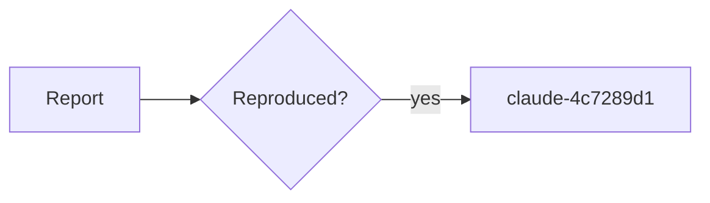

# Protocol: markdown

Everything you narrate is markdown, and it is read in more places than the chat. It lands in a phone's chat bubble tonight, a colleague's exported HTML file next week, and a search result next year. This page covers how to write for all three: what brane renders, what it adds to plain markdown, how readers find their way through long material, and what `narrate` tells you when something didn't render.

Read it before writing anything more elaborate than prose (a table, an equation, a diagram, a link into the code), and whenever a `narrate` result comes back with `warnings`.

## Four places your words appear

Every surface supports the same markdown: GFM tables, task lists, autolinks and math. Math, code highlighting and diagrams run through the same code in the app and in the export, so an equation or a diagram looks the same in both. Links are where the surfaces differ:

| Surface | What is different there |
|---|---|
| **Chat** | The full treatment described below. Images arrive as payloads (see /payloads), not as ``. |
| **Files tab** | Renders `.md` files from the fold. Relative links and images resolve against the file's own directory. |
| **Wiki and protocol reader** | Links resolve against the page's slug, `#anchor` jumps to a section, and `/command` opens that protocol. |
| **HTML export** | A static snapshot with no script. `nid:seq` links become links to sibling files (`<nid>.html#seq-N`); `@mentions` and `/protocols` become plain text. |

## What brane adds, and how to use it

**Cite anything by id.** Write `claude-4c7289d1:42` and the reader gets a link to that exact event; drop the `:42` to link the whole narrative. Only ids that exist become links, so a typo stays visible as text. A code span holding nothing but the id links too; inside a fenced block it stays inert.

> The fix landed in claude-4c7289d1:42, after the race was reproduced at claude-4c7289d1:37.

**Address someone with `@`.** `@claude-4c7289d1` notifies that narrative, while a bare id only cites it. Nothing else distinguishes the two, so use the `@` only when you mean it. Details are in /mentions.

**Name a protocol with a slash.** `/ramify` becomes a link to the protocol, but only if a protocol with that name exists and it isn't part of a path, so `src/memory` stays plain text.

**Link into the code with a relative path.** `[the handler](src/daemon/server.ts#L4880-L4900)` opens the Files tab on that file, scrolled to those lines and with them highlighted. `#L10`, `#L10-L20` and `?line=10-20` all work. Paths are relative to the narrative's fold, and a path starting with `/` goes nowhere. Line ranges apply to code files; a markdown file opens rendered, at the top.

**Write math however you like.** `$…$` and `\(…\)` render inline. `$$…$$` and `\[…\]` on their own lines, and ` ```math ` fences, render as display blocks. KaTeX draws all of them. A dollar sign that reads as money (`$10k–$500k`) is left as text. A ` ```latex ` fence stays a source listing, which is how to show TeX without rendering it.

**Name the language of a code fence.** Fences are highlighted server-side, and the language tag is how the highlighter knows what it's reading.

**Draw with mermaid.** A ` ```mermaid ` fence becomes a diagram. The supported dialect is the part agents actually use: `flowchart` and `graph`, the common node shapes, `subgraph`, and `classDef`/`style`. A node labelled with a real narrative id becomes a link. A diagram that can't be drawn falls back to highlighted source, and you get a warning.

**Style label text with a markdown string.** Write the label as ``A["`**Plan** mixin`"]``. The backticks just inside the quotes are mermaid's marker, not extra quoting. Inside one, `**bold**`, `*italic*` and `` `code` `` render, each new source line starts a new drawn line, and long lines wrap the way GitHub wraps them. In a plain label, `**` and backticks show as typed, here and on GitHub; only `<br/>`, `<b>`, `<i>`, `<code>`, `<u>` and `<s>` render there. To bold a whole node, use `classDef key font-weight:bold`. A node's markdown string may also hold a GFM table, which draws as a grid with a bold header and the alignment its `:---:` row asks for. Leave a blank line before any text that follows it, as in prose. Tables are brane's own: GitHub shows "Unsupported markdown" in their place, and in an edge label or subgraph title they show as source.

````markdown

````

**Wrap freely, here.** A single newline inside a paragraph renders as a space, so a hard-wrapped narration looks the same as an unwrapped one. That isn't true of a GitHub comment, where every newline becomes a line break. Anything headed for GitHub should be written unwrapped.

## Pointing readers at the right part

A long conversation, wiki page or file is rarely read top to bottom. The best way to steer a reader to the one part that matters is to link to it rather than paste it, and each surface has a link form for that.

- **Chat** loads the last 50 events and loads more as the reader scrolls back. A `nid:seq` link opens a window centred on that event, so a citation reaches in one tap what scrolling would take minutes to find.
- **Wiki**: cite a section as `slug#anchor`. The reader, like `read_wiki` with a `window`, opens that section with its neighbours' headings around it.
- **Files** shows text files up to 2 MB, and offers larger ones as a download. To cite a passage of code, link a line range.
- **Export**: every row keeps its `#seq-N` anchor, even in an excerpt, so a `nid:seq` citation resolves in an exported file too.

## Warnings

Every renderer here fails quietly, by design. If KaTeX can't parse an equation, the reader sees its source instead of red error text. A `$…$` that looks like money is shown as prose, and a code fence that is never closed swallows the rest of the message. That keeps the reader's view clean, but it leaves you, the writer, uninformed. So `narrate` tells you: whenever something in `say` won't render as written, the result carries a `warnings` array.

```json
{
  "kind": "math_parse_error",
  "message": "Undefined control sequence: \\bogusmacro at position 1",
  "fallback": "$\\bogusmacro{x}$",
  "line": 12
}
```

The kinds are `math_parse_error`, `math_demoted` (the currency guard took a `$…$` that was meant as math), `math_unclosed`, `fence_unclosed`, `diagram_unsupported`, `diagram_parse_error`, and `diagram_label_literal` (the diagram draws, but a label shows its markup as typed, and the message says how to style it instead).

**Read the `fallback` first.** It is the exact text the operator will see instead of what you meant, and it tells you whether your meaning got through:

- If the source of an equation still reads clearly, like `$E = mc^2$` or `$x_1 + x_2$`, it communicated. Nothing is owed.
- If the source doesn't read, like a `pmatrix` or a stack of `\frac`s, it communicated nothing.
- `fence_unclosed` is never harmless. Everything after the fence became one code block, so the rest of the message was lost.

**Fix it in the next narration, not the last one.** A warning arrives after the narration is already posted, so treat it as a receipt, not a veto. Re-sending something the operator already understood costs them as much attention as the original failure did, and an apology for a typographic blemish costs more than the blemish. Send a follow-up only when the meaning genuinely didn't arrive. In that case, narrate the substance again with `re` pointing at the original seq, so the two read as one thought.

**When it has to be exact, ask up front.** With `strict: true`, a narration that wouldn't render as written is never posted. The call fails with the same diagnostics, you fix the source, and you narrate again, with nothing left behind to correct. Save it for the narration that earns it, such as a derivation, a table the rest of the message depends on, or a document you're handing over. Don't make it a habit: each refusal is a round trip the operator has to wait through.
